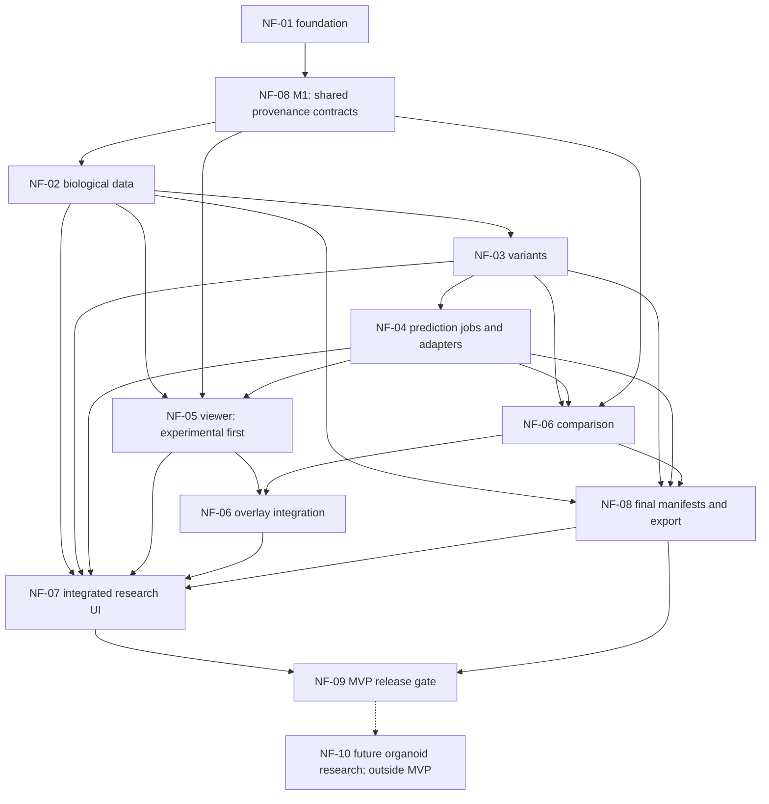

# NF-EPIC-001 — NeuroFold Protein Variant Explorer

Status: proposed roadmap; no application functionality is implemented by these
documents. Planning baseline: NF-01, inspected 2026-11-10. NF-08 M1 shared
[provenance contracts](provenance-contracts.md) and NF-09 M1
[test foundation](testing/README.md) and NF-02 M1
[biological contracts](biological-contracts.md) are implemented.
[NF-02 M2 lookup and pinning](uniprot-lookup.md) are implemented as opt-in Python
services; production remains health-only. Other later milestones remain proposed.

## Objective and scientific motivation

Provide an inspectable research workflow:

**Protein selection → Reference sequence → Variant definition → Prediction →
Visualization → Comparison → Export.**

Researchers studying ALS, Alzheimer's disease, and Parkinson's disease should be
able to explore a protein and a single amino acid substitution while retaining
the exact inputs, evidence, methods, and limitations behind each result. Disease
areas motivate research questions; the MVP does not classify pathogenicity,
diagnose disease, or establish causality from predicted structural differences.

## Repository baseline

Read this plan with [AGENTS.md](../AGENTS.md), [README.md](../README.md), and
[architecture.md](architecture.md). The architecture document describes the
implemented foundation, NF-08/NF-02 M1 contracts and NF-09 M1 tests and remains
authoritative for current behavior. Beyond that baseline and these M1 milestones,
the roadmap below is proposed future work, including endpoint names and packages.

- Backend: Python 3.12+, FastAPI application factory, and `GET /health` only.
  `core/prediction.py` contains frozen `PredictionRequest(sequence, seed)`,
  `PredictionResult(structure_path, provenance_path)`, and a synchronous
  `PredictionAdapter.predict(request, *, output_dir)` protocol.
- Frontend: React function components, strict TypeScript, Vite, and service status.
  Browser `/api/*` requests are proxied to backend `/*` in development.
- CI: locked uv/npm installs, Ruff, mypy strict, pytest with 90% coverage minimum,
  ESLint, TypeScript, frontend build, and Linux container smoke tests.
- NF-02 M1 adds frozen biological records, protocols, HTTP DTO/schema contracts,
  synthetic contract tests and a source licensing inventory; operational routes
  remain deferred. NF-02 M2 adds a UniProt client, bounded cache/cursors and
  immutable filesystem reference pinning; there is no variant service, viewer,
  inference runtime,
  job system, database, authentication, or export implementation.

Preserve the Apache-2.0 LICENSE and attribution. No application code, dependency,
lockfile, infrastructure, or existing documentation change is required to adopt
this roadmap.

## MVP scope and boundaries

The MVP supports explicit selection of a public UniProtKB canonical sequence,
organism and version; discovery of experimental PDB structures; one validated
substitution; separate reference and variant sequence predictions; viewing; a
documented comparison; and an integrity-checkable export. Protein accession and
gene search both require user disambiguation where necessary. A missing structure
does not prevent sequence exploration or prediction.

The first prediction profile is a single protein chain without ligands, custom
constraints, or post-translational modifications. Predict both unmodified and
mutated sequences with a matched, recorded protocol. An experimental structure
may additionally contextualize either prediction but is not automatically an
unmodified or complete reference. Assemblies and missing residues remain visible.

CPU-only development and CI use synthetic data and a clearly labeled fake
adapter. A real scientific MVP release additionally requires a separately
validated Boltz-2 worker on Linux/NVIDIA CUDA; a fake-only preview cannot satisfy
that release gate. No Boltz-2 installation or execution belongs in this planning
task or in NF-02.

Out of scope: clinical interpretation, variant pathogenicity scores, stability
or aggregation predictions, binding-affinity claims, automated wet-lab design,
indels, multiple simultaneous substitutions, isoform editing, complex prediction,
public multi-user hosting, patient/private sequence uploads, and organoid analysis.
Record rejected inputs rather than silently approximating them.

## Task specifications

| Task | Deliverable | Dependencies |
| --- | --- | --- |
| [NF-02 Biological data](tasks/NF-02-biological-data.md) | UniProt/RCSB adapters, immutable reference snapshots and structure imports | NF-01; NF-08 M1 contracts |
| [NF-03 Protein variants](tasks/NF-03-protein-variants.md) | Validated, immutable substitution definitions | NF-02 snapshots; NF-08 M1 |
| [NF-04 Prediction engine](tasks/NF-04-prediction-engine.md) | Durable jobs, fake adapter, isolated Boltz-2 worker | NF-03; NF-08 M1 |
| [NF-05 Molecular viewer](tasks/NF-05-molecular-viewer.md) | Mol* viewing, mapped selection and confidence display | NF-02 imports/mapping; NF-08 M1; NF-04 for predicted artifacts |
| [NF-06 Structure comparison](tasks/NF-06-structure-comparison.md) | Explicit mapping, alignment and reproducible metrics | NF-03; NF-04; NF-08 M1; NF-05 for overlays |
| [NF-07 Research workflow](tasks/NF-07-research-workflow.md) | Integrated UI with recoverable states and provenance | NF-02 through NF-06; NF-08 export |
| [NF-08 Reproducibility](tasks/NF-08-reproducibility.md) | Early shared schemas, ongoing capture, final exports | M1: NF-01; final export: NF-02/03/04/06 |
| [NF-09 Release](tasks/NF-09-release.md) | Continuous tests and documentation; final release evidence | Test planning: NF-01; release: NF-02 through NF-08 |
| [NF-10 Organoid research](tasks/NF-10-organoid-future.md) | Future research specification only | Post-MVP; new scientific and data-governance review |

Each task has ten sections covering motivation, scope, dependencies, architecture,
contracts, milestones, acceptance, tests, scientific considerations, and decisions.
Milestone labels are local to their task. NF-08 M1 is an early contract milestone,
not a dependency on completing all of NF-08.

## Dependency graph

Arrows indicate prerequisite → consumer. Dashed arrows describe future work.
NF-09 tests accompany every task even though its final gate appears last.



## Recommended implementation order

1. **Contract preparation:** NF-08 M1 defines canonical hashes, evidence labels,
   artifact descriptors and manifest versioning. NF-09 M1 defines fixture policy,
   test layers and the scientific release checklist. No scientific runtime needed.
2. **Biological foundation:** NF-02 snapshots, lookup, structure metadata/import,
   upstream failure handling; then NF-03 pure substitution validation. Finish
   tests with each increment, not at the end of the epic.
3. **First inspectable slice:** NF-05 experimental viewing and NF-07 protein,
   sequence and variant screens can follow those stable contracts. NF-04 M1–M3
   adds isolated job execution and fake results; connect progress and predicted
   viewing before provisioning a GPU runtime.
4. **Scientific execution:** resolve NF-04's pinned model/license/MSA/hardware
   gates, build the separate Linux worker and run reviewed smoke experiments.
   NF-06 adds mapping and comparison with analytic synthetic fixtures before
   interpreting real predictions. Integrate its overlays with NF-05.
5. **Complete the record:** finish NF-08 exports and NF-07 error recovery,
   provenance and accessible interaction. Validate an exported run independently.
6. **Release:** NF-09 completes CPU CI, container checks, opt-in GPU evidence,
   scientific review and contributor/user documentation. Keep NF-10 deferred.

This order allows parallelizable development without making numerical task IDs a
waterfall or postponing provenance until outputs already exist. It does not
authorize delegation or implementation in this documentation change.

## Shared architectural decisions

Maintain **API → core ← adapters**. Proposed `application/` services coordinate
core protocols and receive adapters through an explicit composition root. They
import neither HTTP schemas nor concrete model runtimes. `api/` owns Pydantic
schemas and HTTP translation. `core/` owns frozen standard-library domain records,
validation policies and protocols. `adapters/` contains biological HTTP clients,
storage implementations, numerical engines and explicitly selected model code.
Scientific libraries used for parsing/alignment must stay behind adapters.

The existing synchronous `PredictionAdapter` remains the worker-side seam.
NF-04 explicitly evolves its minimal request/result records and tests callers;
the HTTP API never calls `predict`. Core imports and `/health` must work without
model libraries, weights, networks, database initialization or GPUs.

Use local ignored `data/` for public source snapshots and `outputs/` for immutable
artifacts. NF-02/03 use an injected filesystem snapshot repository; unit tests use
memory or temporary directories. Only when NF-04 introduces durable jobs, add a
standard-library SQLite job repository for one API process and one separately
launched worker on the same host. This is local coordination, not a broker or a
general research database. Do not place SQLite on shared network storage. A
future remote GPU topology replaces dispatch/storage adapters; no Redis, hosted
database, cloud account, authentication service or Kubernetes is an MVP dependency.
Deployment beyond a trusted single-operator environment needs its own security
design before exposure.

## Shared identifiers, schemas and HTTP conventions

These are proposed `/v1` backend routes; browsers use `/api/v1` through existing
development routing. `GET /health` retains its NF-01 liveness contract. Production
must configure equivalent API routing before a deployed workflow is supported.

| Concept | Required identity and semantics | Owner |
| --- | --- | --- |
| Reference | Opaque immutable `reference_id`, accession, canonical/isoform identity, NCBI taxon, sequence, sequence/entry versions, source receipt | NF-02 |
| Variant | Content-derived `variant_id`, reference ID/hash, one 1-based substitution, mutated sequence/hash, schema version | NF-03 |
| Structure | Immutable `structure_id`, raw artifact SHA-256, evidence kind, format, entity/chain/model/assembly identity, mapping reference | NF-02/04 |
| Residue mapping | Reference ID/hash, structure ID/hash, model, chain and assembly operator, label/auth residue IDs, insertion code, mapping status/method | NF-02 basic; NF-06 comparison |
| Job | Opaque `job_id`, immutable request hash, adapter/profile ID, lifecycle, attempts, timestamps, artifacts and manifest ID | NF-04 |
| Comparison | Immutable `comparison_id`, ordered structure IDs, chain/model choices, mapping, fit/evaluation selections, method/version, metrics | NF-06 |
| Manifest/export | Schema version, references to immutable inputs/artifacts, hashes, full execution/comparison provenance and license inventory | NF-08 |

Evidence kinds are `experimental`, `predicted`, and `synthetic`. Interpretations
are separately labeled hypotheses. Synthetic outputs must never be represented
as predictions or experimental observations. Nullable metadata must include an
explicit unavailable/not-applicable reason where scientific interpretation depends
on it. Missing metrics are not zero.

For all new HTTP endpoints, use a stable error envelope:

```json
{
  "error": {
    "code": "REFERENCE_MISMATCH",
    "message": "The selected reference has a different residue at this position.",
    "retryable": false,
    "details": {"position": 4, "expected": "A", "observed": "T"},
    "request_id": "opaque-correlation-id"
  }
}
```

Translate framework validation errors to this envelope for new `/v1` routes;
preserve existing health behavior. Use 400 for malformed query/cursor syntax,
404 for unknown records, 409 for stale snapshots/idempotency or lifecycle
conflicts, 413 for size limits, 422 for domain validation, 429 for local admission
limits, 502 for invalid upstream data, 503 for unavailable upstream/worker
capacity, and 504 for upstream timeouts. Do not expose filesystem paths, credentials
or raw subprocess stderr. Partial structure discovery is a successful response
with explicit availability/warnings, not an empty result presented as complete.

NF-08 M1 defines canonical encoding before content IDs are implemented. Hash raw
artifact bytes separately from normalized sequence bytes and canonical request
JSON. Accessions and seeds alone do not identify reproducible inputs.

## Epic acceptance and release gates

- A researcher can finish the full workflow on a supported public protein and
  valid substitution, and inspect the exact reference and mutated sequences.
- CPU CI exercises the full flow with synthetic fixtures/fake inference; the UI
  and exports identify those outputs as synthetic. Real Boltz-2 acceptance is
  separately demonstrated on a reviewed, versioned Linux/CUDA runtime.
- Failed upstream requests, absent coordinates, unsupported inputs, interrupted
  jobs, unavailable confidence and incompatible comparisons produce explicit,
  recoverable outcomes without fabricated results.
- Alignment reports include mapping coverage, atom selection, units, transforms,
  missing-data policy and uncertainty. No metric is a disease-causality result.
- An exported record includes verified hashes, raw outputs where redistribution
  is allowed, model/weight/environment identities, comparison definitions and
  citations/licenses; it opens and verifies without upstream services.
- Required repository checks and new behavior tests pass with locked installs.
  Documentation explains supported scope, limitations, local fake execution and
  separately provisioned real inference. NF-09 records evidence for every gate.

## Decisions that remain open

| Decision | Proposed default / work that can proceed | Must resolve before |
| --- | --- | --- |
| Scientific target panel | Public canonical monomers first; select targets with documented structural context and discuss disorder/assemblies | NF-04 real validation and NF-09 scientific release |
| Boltz-2 version and weights | Pin an independently reviewed release, source revision, checksums and exact notices; do not follow `latest` | NF-04 real worker build |
| MSA inputs and external disclosure | Explicit local MSA artifacts preferred for controlled runs; network MSA generation requires disclosed opt-in and captured artifacts | First real prediction |
| Worker limits and GPU | One job at a time; set sequence/sample/time/memory limits from hardware measurements, not guessed capacity | NF-04 real profile enabled |
| Scientific parser/alignment library | Optional adapter dependency with license review; core retains only standard-library records and policies | NF-02 mapping implementation; NF-06 numerical implementation |
| Low-confidence reporting policy | Show unfiltered metrics plus explicitly selected filtered results; record threshold and scale | NF-06 acceptance |
| Local retention and redistribution | Configurable local retention, no deletion during active jobs/export; independent source/weight/data terms | NF-08 export and NF-09 operational documentation |
| Remote execution | Protocol and immutable bundle seam only; transport, trust and artifact hosting need a later deployment decision | Any remote or multi-user deployment |

These decisions constrain later milestones; they do not block writing this plan.
Changing a default during implementation requires updating the task contract and
its tests before dependent work proceeds.

## Primary references

Upstream contracts are moving targets. These primary sources were consulted on
2026-11-10; implementations must pin/recheck the relevant versions, not treat
this roadmap as an upstream compatibility guarantee.

- UniProt's authors document programmatic entry retrieval, pagination and release
  headers in [The UniProt website API](https://pmc.ncbi.nlm.nih.gov/articles/PMC12230682/).
- RCSB separates discovery from entity/instance metadata in its
  [Search API](https://search.rcsb.org/) and [Data API](https://data.rcsb.org/).
  [PDBx/mmCIF](https://mmcif.wwpdb.org/docs/user-guide/guide.html) defines coordinate
  and residue identifiers used by the mapping contract.
- [Boltz prediction documentation](https://github.com/jwohlwend/boltz/blob/main/docs/prediction.md)
  informs the adapter boundary; [upstream model documentation](https://github.com/jwohlwend/boltz)
  informs, but does not replace, the exact artifact license review.
- Mol* documents [plugin creation](https://molstar.org/docs/v5/plugin/instance/)
  and [structure selections](https://molstar.org/docs/v5/plugin/selections/).
- Rigid fitting follows the method described by
  [Kabsch (1976)](https://doi.org/10.1107/S0567739476001873), with the specific
  fit/evaluation policies defined in NF-06.
