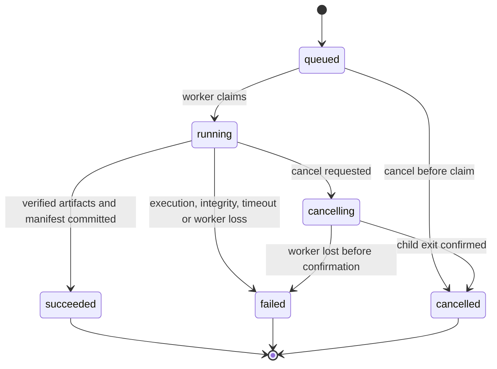

# NF-04 — Molecular Prediction Engine

Status: **M1 implemented and verified; M2–M5 proposed.**
[Contract decisions](../prediction-contracts.md) and
[executed evidence](../testing/nf04-m1-evidence.md). Parent: [NF-EPIC-001](../EPIC.md). Initial real adapter target:
Boltz-2; no installation or inference is authorized by this planning document.

## 1. Objective and scientific motivation

Execute traceable structural predictions for exact reference and substituted
sequences through interchangeable model adapters. Keep slow or GPU-dependent
execution outside HTTP handling while preserving inputs and failures for audit.
The output is a computational model, not measured structure or a variant-effect
assay.

## 2. Scope and non-goals

Include capability discovery, validated job submission, durable lifecycle,
separate worker execution, cancellation, bounded resources, fake inference,
one-chain Boltz-2 translation, immutable artifacts and full provenance.

MVP inputs are canonical single polypeptides. The application constructs mutated
sequences using NF-03 before model translation. The adapter does not receive
`A4V` and infer its meaning, and it does not mutate an experimental coordinate
file. Reference and variant are independent jobs using a matched profile.

Exclude API-embedded inference, FastAPI background-task execution, GPU packages
in the API environment, automatic weight downloads at startup, model training,
multi-chain/ligand/affinity workflows, stability or pathogenicity scoring,
high-throughput scheduling and a distributed broker. Boltz-2 is an initial target,
not a guarantee that all neurodegeneration-relevant systems can be modeled well.

## 3. Dependencies

- [NF-03](NF-03-protein-variants.md) immutable definitions and mutated sequence.
- NF-02 exact source snapshots and artifact access.
- [NF-08 M1](NF-08-reproducibility.md) request hashing, manifests, evidence kinds,
  license records and artifact integrity rules.
- NF-09 defines CPU tests and the opt-in real-runtime validation gate. NF-05/06
  consume descriptors and metric definitions rather than runtime-specific files.

## 4. Proposed architecture and interfaces

`PredictionService.submit/get/cancel` lives in a proposed `application/` package
and depends on core `JobRepository`, `ArtifactStore`, `WorkerDispatcher` and
adapter capability records. HTTP handlers validate/submit/return; they do not
import or invoke a model. Composition selects storage/dispatch implementations.

Preserve the synchronous worker seam:
`PredictionAdapter.predict(request, *, output_dir) -> PredictionResult`.
Evolve the existing NF-01 frozen records explicitly: request adds versioned,
typed profile/parameter/source references; result adds multiple sample descriptors,
confidence/artifact references and a manifest reference while retaining or
deliberately migrating the current path fields. Update the protocol's tests and
all callers in M1; do not maintain conflicting legacy and rich contracts. Core
uses standard-library types only; arbitrary dictionaries cannot bypass profile
validation. Paths are worker-internal, never public artifact URLs.

Introduce SQLite **only here**, for durable job metadata and transactional
claim/status/idempotency operations; use the standard-library adapter behind
`JobRepository`. Immutable scientific inputs/outputs remain in ignored filesystem
stores. Initial topology: one API process and one separately launched worker on
one host, one running job at a time. Atomic claim/version checks prevent duplicate
execution; worker/API mutations use short transactions, never locks held through
inference. No network filesystem for this database.

The API inserts a queued job; the independently started worker polls/claims it.
The worker launches the selected adapter in a child process with an isolated
attempt directory and explicit timeout. It supervises heartbeats and cancellation,
terminates the child process group when required, waits for exit, and verifies
outputs before publishing. All writes are staged then atomically registered.
`/health` remains pure liveness and does not initialize the repository or runtime.

For Linux/NVIDIA, provision a separate, pinned worker environment/image and
lockfile, including its exact supported Python version and CUDA/PyTorch/runtime
dependencies. API Python 3.12+ support is unchanged; if the selected upstream model
requires a different worker Python, document the isolated compatibility boundary.
Model imports occur only after selecting that adapter in the child. macOS and
ordinary CI run the fake adapter without weights, network or scientific runtime.

Future remote execution uses a versioned immutable input bundle and output manifest
through dispatch/artifact protocols. It must not require shared local paths or
direct API database access. Transport, authenticated worker trust, leases and
object storage are a later deployment decision; do not claim local SQLite solves
remote scheduling.

## 5. Data models and API contracts

| Record | Required content |
| --- | --- |
| `AdapterCapability` | adapter/profile/version, evidence kind, supported alphabet/molecule types, parameter schema/defaults, sequence/sample/time limits, MSA modes, runtime availability and reason |
| `PredictionSpec` | schema version, reference ID/hash, optional variant ID, exact input sequence/hash, adapter/profile version, complete resolved parameters, seed, MSA/template/constraint artifact IDs/hashes or explicit none, code identity |
| `PredictionJob` | job ID, immutable spec/hash, state/version, submission/start/end times, cancellation flag, attempt ID, worker/lease identity, heartbeat, parent retry ID, sanitized error, result/manifest IDs |
| `PredictionSample` | sample ID, model-returned rank plus ranking definition, structure descriptor, chain/token-to-residue map, confidence descriptors, raw artifact IDs/hashes |
| `PredictionResult` | all samples, manifest ID/hash, raw output inventory, warnings; worker validates before success |

`seed` is an explicit integer in the selected profile's documented range. Resolve
all defaults before request hashing. Reject unknown parameters and incompatible
MSA modes; never pass arbitrary CLI flags, paths or shell fragments from HTTP.
The server loads sequences from immutable records, recomputes hashes, and does
not trust sequence bytes supplied alongside an ID.

| Method/path | Contract |
| --- | --- |
| `GET /v1/prediction-capabilities` | 200 explicit profiles/limits/availability; fake profile labeled `synthetic`; no runtime import or weight download |
| `POST /v1/prediction-jobs` | `{reference_id, variant_id: null\|id, adapter_profile_id, parameters, seed, msa_artifact_id: null\|id}` plus required `Idempotency-Key`; 202 job with `Location` |
| `GET /v1/prediction-jobs/{job_id}` | 200 state, timestamps, stage, nullable progress, warnings, error and registered results; 404 unknown |
| `POST /v1/prediction-jobs/{job_id}/cancel` | 202 when cancellation is pending; 200 for already-cancelled; 409 for succeeded/failed terminal jobs |

One idempotency key reused with the same resolved spec returns the existing job;
different content returns 409 `IDEMPOTENCY_CONFLICT`. Record keys durably for the
job's retention period. Explicit retries use a new key/job ID and `retry_of_job_id`
in the submission schema; they retain the prior failure rather than overwrite it.
Reject incompatible reference/variant pairs with 422, missing records with 404,
admission limits with 429, and unconfigured worker/profile with 503. Accepted jobs
can fail later; a 202 response is not a scientific result.

Terminal jobs are immutable. Cancellation racing with success is serialized:
whichever terminal commit/transition wins determines the response; no success may
be committed from `cancelling`. Partial attempt files remain non-result artifacts.
Use a proposed 5-second heartbeat and 60-second lease for the local supervisor;
test with a fake clock and tune before deployment. After lease expiry, fence the
attempt and mark `failed/WORKER_LOST`; late output from the fenced attempt cannot
publish. Do not automatically rerun possibly completed inference. Stage progress
is nullable: show `queued`, `preparing`, `inference`, `validating`, not invented
percentages. Capacity and execution deadlines are required profile settings.

### Boltz-2 adapter translation and scientific outputs

Translate the exact constructed sequence to the pinned release's documented
protein YAML schema, chain `A`. Boltz's current
[prediction documentation](https://github.com/jwohlwend/boltz/blob/main/docs/prediction.md)
describes custom MSAs, optional server-generated MSAs, a single-sequence mode,
structure files and confidence outputs. Reverify this against the selected release.
Make MSA policy explicit per job: stored local MSA, disclosed opt-in remote
generation, or explicitly selected single-sequence mode with a limitation warning.
Never silently change modes when a service fails. Validate each MSA query against
the exact input sequence; reusing a reference MSA for a variant requires a recorded,
reviewed query-row transformation, not accidental cache reuse.

Keep each job in a fresh output directory so upstream cache/override behavior
cannot substitute an earlier run. Capture the emitted input YAML, processed inputs,
MSA/template artifacts, command arguments, logs, coordinates and confidence files
as permitted. Network MSA generation transmits the sequence; explain this before
submission and record endpoint/version/time and returned bytes.

Normalize supported per-residue confidence, pTM, and optional PAE/PDE only with
explicit source fields, scales, units and token/residue mapping. Preserve raw
values and files. Interface metrics are unavailable for a monomer where not
scientifically applicable; absence is not zero. Do not infer scale from magnitude
or treat generic B-factors as confidence. Export every returned sample and its
ranking policy; selection of a displayed sample must remain visible.

These outputs support model inspection and cautious geometric comparison. They do
not directly measure mutation-induced stability, aggregation, toxicity or disease
causality. Affinity outputs are outside this single-chain MVP.

## 6. Implementation milestones

1. **M1 — Contracts/capabilities (complete):** one authoritative evolved NF-01
   seam; strict versioned capabilities, resolved inputs, lifecycle/attempt/fencing,
   samples/maps/confidence and complete successful-provenance contracts; pure
   publication validation, safe typed errors, schemas and offline synthetic tests.
   No execution/storage implementation. See the linked guide/evidence above.
2. **M2 — Durable orchestration:** SQLite adapter, transactional transitions,
   idempotency, isolated child supervisor, leases, artifact publication and routes.
3. **M3 — Fake vertical slice:** deterministic synthetic coordinates and known
   confidence, injected failures/timeouts, separate CPU worker and frontend polling.
   Fake execution is never a fallback for a failing real model.
4. **M4 — Real-runtime gate:** choose exact Boltz-2 revision/weights, verify
   licenses and checksums, lock separate dependencies, select MSA policy and test
   limits on named Linux/NVIDIA hardware. Document startup commands at this stage.
5. **M5 — Boltz-2 integration:** translate inputs, supervise real execution,
   validate mappings/confidence/provenance and run reviewed reference/variant
   smoke experiments. Record limitations and release evidence for NF-09.

## 7. Acceptance criteria

- API startup, health, domain tests and fake execution work with no GPU/model
  package. Accepted jobs remain queryable across API restart.
- A separate worker claims a job once; crashes, expired leases, cancellation,
  timeout and failed artifact validation cannot produce a successful record.
- Submitted reference/variant sequences and hashes match NF-02/03 exactly. Matched
  comparisons expose any difference in profile, parameters, MSA or environment.
- Real execution is enabled only for a reviewed pinned runtime with explicit
  limits, weight identities/licenses and input-disclosure policy.
- All returned samples/raw outputs and their manifests are preserved; missing
  confidence and unsupported inputs have explicit reasons.
- Remote execution can be added through protocol implementations without model
  imports or shared-path assumptions in API/core.

## 8. Automated testing requirements

Fake-adapter unit/API tests cover valid reference/variant jobs; parameter/default
hashing; unsupported alphabets/limits; unknown records/profiles; idempotency;
state transitions; duplicate claims; cancellation at each stage; success races;
timeouts; restart/lease expiry; stale worker publication; disk full; corrupt,
missing or mismatched outputs; and safe error serialization. Test child cleanup
with a harmless controllable subprocess, not actual inference. Verify queued and
completed jobs survive repository reopening.

Contract tests validate every route/status and artifact/manifest link. Import
tests forbid optional model/numerical imports in API/core and verify health is
independent of job/worker availability. Adapter translation tests use synthetic
YAML/output fixtures and mocked subprocess boundaries, not weights.

Opt-in Linux/NVIDIA tests exercise the pinned real adapter, MSA handling, memory/
time limits, coordinate/confidence mapping and provenance on public reviewed
inputs. They are separate from offline CPU CI. Use justified numerical tolerances
and inventory invariants, not GPU byte-for-byte golden coordinates.

## 9. Scientific validity and reproducibility

NF-08 captures input/source hashes, adapter/model revisions, checksummed weights
and license, resolved parameters, seed, preprocessing/MSAs/templates, lockfiles,
code revision/dirty state, OS, CPU/GPU, driver, CUDA and relevant library versions.
Pin runtime image digests; the existing development image tags are insufficient
scientific runtime identity. Record known nondeterminism and all sample selection.

Compare reference/variant predictions under a declared matched protocol, and
report sample/seed variation where multiple runs exist. A single matched seed
does not isolate a causal mutation effect or guarantee identical GPU execution.
Discuss disorder, missing biological partners, constructs and training overlap;
the MVP is not an independent accuracy benchmark or an in-vivo mechanistic assay.

Upstream currently describes code and weights as MIT in its
[repository](https://github.com/jwohlwend/boltz). Verify the exact selected code,
weights, auxiliary databases and MSA service terms independently before M4; record
their notices and redistribution permissions. NeuroFold's Apache-2.0 license does
not replace those terms.

## 10. Risks and unresolved decisions

- **Real profile:** exact release, weights, CUDA stack, GPU memory and sequence/
  sampling limits are unresolved until M4 measurements. Fake work can proceed.
- **MSA disclosure/reproducibility:** choose reviewed local databases or an
  explicitly disclosed server policy, retain returned artifacts, and document
  licensing/storage constraints. Unrecordable preprocessing is a release blocker.
- **Protocol migration:** the NF-01 path-only result is insufficient for multiple
  samples/confidence. M1 must make one authoritative versioned contract.
- **Local coordination:** SQLite plus local files supports the declared single-host
  topology only. Remote workers need a separate deployment/security design.
- **Scientific applicability:** target selection must include relevant monomer/
  assembly/disorder limitations; failure on a target is reportable, not replaceable
  by a plausible synthetic result.

## M1 boundary and carried gates

The public interfaces/identity documents and exact versions are specified in
[the prediction guide](../prediction-contracts.md). NF-02/NF-03/NF-08 frozen
records, identity/fixture bytes and archive semantics are preserved. The NF-08
skeleton still cannot certify successful predictions. The authored capability
profile is contract-only, not fake execution or measured real capacity.

M2 owns SQLite/idempotency, transactional final fencing/state checks, staging and
publication, supervisors and routes; M3 owns executable synthetic inference and
its vertical slice; M4 chooses reviewed pinned real releases/licenses/weights and
measures named hardware; M5 integrates real Boltz-2 execution. Independent review
remains required at the real prediction/comparison gates. The NF-03 M3 container
gap is carried forward: Compose configuration passed historically, but the stopped
daemon prevented builds/smokes. Contract design is not blocked; close that gap
when execution infrastructure changes, without relabeling historical evidence.
